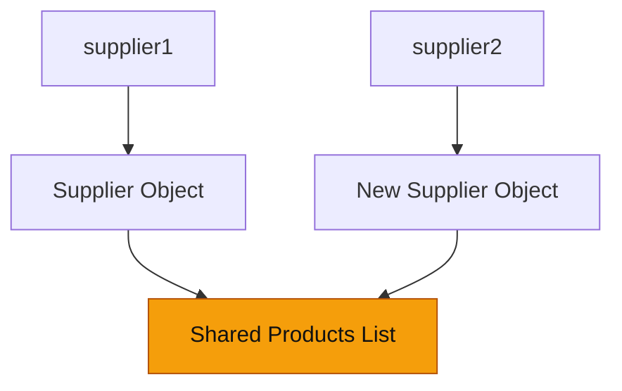
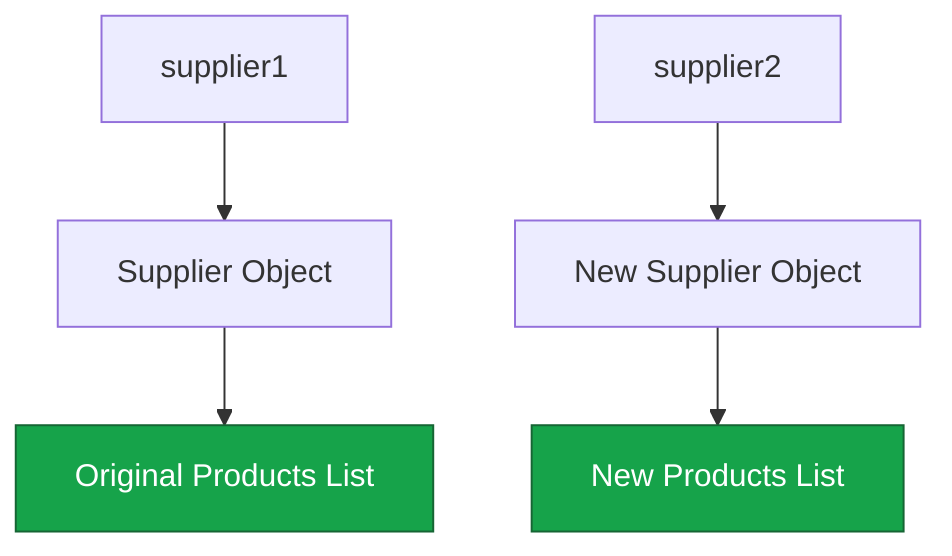

# Shallow Copy vs Deep Copy in C#

> فهم الفرق بين النسخ السطحي والنسخ العميق أساسي لفهم كيفية التعامل مع الـ Objects والـ Reference Types في C#.

## Table of Contents

- [1. The Core Idea](#1-the-core-idea)
- [2. Shallow Copy](#2-shallow-copy)
- [3. Deep Copy](#3-deep-copy)
- [4. Shallow Copy vs Deep Copy](#4-shallow-copy-vs-deep-copy)
- [5. Nested Reference Types](#5-nested-reference-types)
- [6. When Should You Use Each One?](#6-when-should-you-use-each-one)
- [7. Key Takeaway](#7-key-takeaway)

---

## 1. The Core Idea

لما ننسخ Object في C#، السؤال مش بس: هل صار عندنا Object جديد؟

السؤال الأهم هو: **هل الكائنات الموجودة داخل النسخة مستقلة عن الأصل، أم ما زالت مشتركة بينهما؟**

عندنا نوعان مشهوران من النسخ:

| النوع | الفكرة |
|---|---|
| **Shallow Copy** | إنشاء Object جديد ونسخ قيم أعضائه. مراجع الـ Reference Types تظل تشير إلى نفس الكائنات. |
| **Deep Copy** | إنشاء Object جديد، مع إنشاء نسخ مستقلة من الكائنات الداخلية التي نريد فصلها عن الأصل. |

## 2. Shallow Copy

الـ **Shallow Copy** ينشئ نسخة جديدة من الـ Object، لكنه لا ينشئ نسخاً جديدة من الكائنات المشار إليها بواسطة الـ Reference Types الموجودة داخله.

### Example

```csharp
public class Supplier
{
    public int SupplierID { get; set; }

    public List<string> Products { get; set; } = new();

    public Supplier CreateShallowCopy()
    {
        return (Supplier)MemberwiseClone();
    }
}
```

لدينا نوعان من البيانات:

- `int` — **Value Type**: تُنسخ قيمته إلى النسخة.
- `List<string>` — **Reference Type**: تُنسخ قيمة المرجع، وليس القائمة نفسها.

### Creating the Copy

```csharp
var supplier1 = new Supplier
{
    SupplierID = 1,
    Products = ["Laptop", "Mouse"]
};

var supplier2 = supplier1.CreateShallowCopy();
```

ما الذي حدث؟

1. تم إنشاء Object جديد من `Supplier`.
2. تم نسخ قيمة `SupplierID`.
3. تم نسخ الـ Reference الخاص بـ `Products`.
4. أصبح الـ Objectان يشيران إلى نفس القائمة.

### Shallow Copy Diagram



### Practical Example

```csharp
supplier2.Products.Add("Keyboard");

Console.WriteLine(supplier1.Products.Count); // 3
Console.WriteLine(supplier2.Products.Count); // 3
```

النتيجة `3` في الحالتين؛ لأن `supplier1.Products` و `supplier2.Products` يشيران إلى نفس القائمة.

لكن لو غيّرنا قيمة `SupplierID` في نسخة واحدة:

```csharp
supplier2.SupplierID = 2;

Console.WriteLine(supplier1.SupplierID); // 1
Console.WriteLine(supplier2.SupplierID); // 2
```

لن تتغير قيمة الكائن الأصلي؛ لأن كل Object لديه قيمة مستقلة لخاصية `SupplierID`.

> **ملاحظة:** `MemberwiseClone()` تنفذ Shallow Copy، وهي method محمية `protected` في `object`؛ لذلك يمكن استدعاؤها من داخل الـ Class نفسه.

## 3. Deep Copy

الـ **Deep Copy** ينشئ Object جديداً، وينشئ أيضاً نسخاً مستقلة من الكائنات الداخلية التي نريد ألا تكون مشتركة مع الأصل.

### Example

```csharp
public class Supplier
{
    public int SupplierID { get; set; }

    public List<string> Products { get; set; } = new();

    public Supplier CreateDeepCopy()
    {
        return new Supplier
        {
            SupplierID = this.SupplierID,
            Products = new List<string>(this.Products)
        };
    }
}
```

لاحظ ما فعلناه:

1. أنشأنا Object جديداً من `Supplier`.
2. نسخنا قيمة `SupplierID`.
3. أنشأنا `List<string>` جديدة.
4. نسخنا عناصر القائمة إلى القائمة الجديدة.

### Deep Copy Diagram



### Practical Example

```csharp
var supplier2 = supplier1.CreateDeepCopy();

supplier2.Products.Add("Keyboard");

Console.WriteLine(supplier1.Products.Count); // 2
Console.WriteLine(supplier2.Products.Count); // 3
```

هذه المرة لم تتأثر القائمة الأصلية؛ لأن كل Object يمتلك قائمة مستقلة.

## 4. Shallow Copy vs Deep Copy

| وجه المقارنة | Shallow Copy | Deep Copy |
|---|---|---|
| إنشاء Object جديد | نعم | نعم |
| نسخ قيم Value Types | نعم | نعم |
| نسخ مراجع Reference Types | نعم، كما هي | إنشاء كائنات مستقلة حسب الحاجة |
| مشاركة الكائنات الداخلية | ممكنة | لا، بالنسبة للكائنات التي تم نسخها بعمق |
| تعقيد التنفيذ | غالباً أبسط | يحتاج تحديد ونسخ الكائنات الداخلية |

## 5. Nested Reference Types

لو كانت القائمة تحتوي على Objects قابلة للتعديل، مثل `List<Product>`، فإن إنشاء قائمة جديدة وحده **لا يكفي** لعمل Deep Copy كامل.

### Product Example

```csharp
public class Product
{
    public string Name { get; set; } = string.Empty;
    public decimal Price { get; set; }
}

public class Supplier
{
    public int SupplierID { get; set; }
    public List<Product> Products { get; set; } = new();
}
```

هذا الكود ينشئ قائمة جديدة، لكنه ينسخ مراجع المنتجات الموجودة داخل القائمة:

```csharp
var copiedProducts = new List<Product>(supplier.Products);
```

وبالتالي ستظل كائنات `Product` مشتركة بين القائمتين.

### Creating Independent Product Objects

```csharp
var supplierCopy = new Supplier
{
    SupplierID = supplier.SupplierID,
    Products = supplier.Products
        .Select(product => new Product
        {
            Name = product.Name,
            Price = product.Price
        })
        .ToList()
};
```

الآن تم إنشاء قائمة جديدة، وكل عنصر `Product` داخلها هو Object جديد.

### Why Is `string` Different?

الـ `string` هو Reference Type، لكنه **Immutable**؛ أي لا يمكن تغيير محتواه بعد إنشائه.

لذلك، عند نسخ `List<string>` إلى قائمة جديدة، لا نحتاج عادةً إلى إنشاء String جديدة لكل عنصر. مشاركة مراجع الـ strings لا تسبب مشكلة تعديل؛ لأن محتوى الـ string لا يتغير.

> الـ Deep Copy يعتمد على بنية الكائنات. إذا كان داخل Object كائن آخر يشير إلى كائنات إضافية، فيجب تحديد مدى النسخ المطلوب لكل مستوى.

## 6. When Should You Use Each One?

- استخدم **Shallow Copy** عندما تكون مشاركة الكائنات الداخلية مقصودة ومقبولة، أو عندما تكون البيانات الداخلية غير قابلة للتغيير.
- استخدم **Deep Copy** عندما تحتاج نسخة مستقلة لا تؤثر تعديلات كائناتها الداخلية على الأصل.
- لا تفترض أن إنشاء Object جديد يعني أن كل ما بداخله أصبح مستقلاً.

## 7. Key Takeaway

```text
Shallow Copy
New Object
  ├── Value Types: Independent Values
  └── Reference Types: Shared References

Deep Copy
New Object
  ├── Value Types: Independent Values
  └── Reference Types: New Objects as Needed
```

**الفكرة الأساسية:**

الفرق الحقيقي ليس في عدد الـ Objects التي أنشأناها، بل في **هل الكائنات الداخلية مشتركة أم مستقلة؟**
